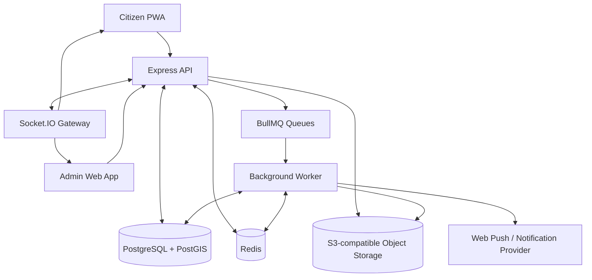
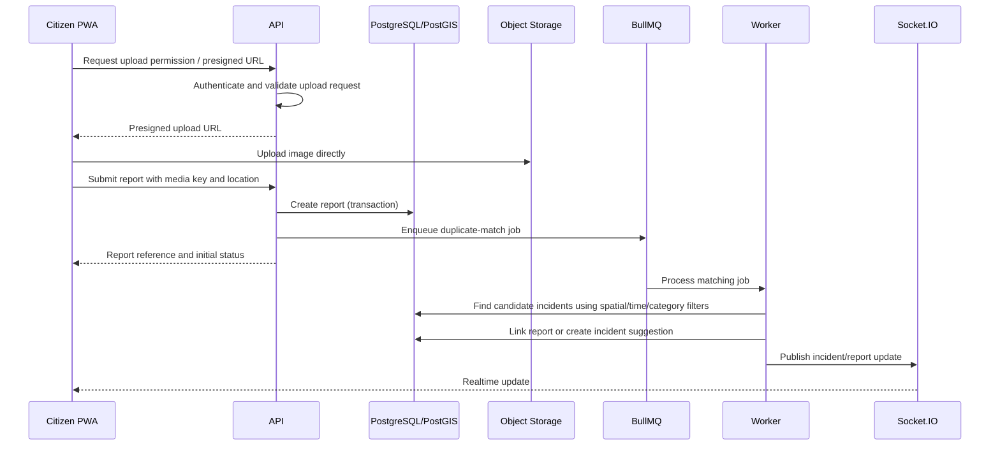
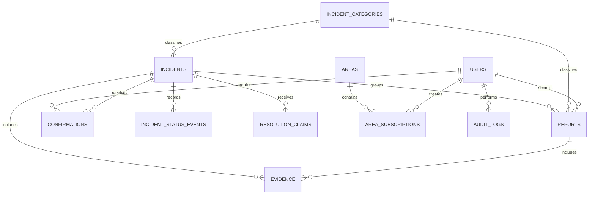

# System Architecture

## Hyperlocal Community Safety Network

**Version:** 1.0  
**Architecture style:** Modular monolith + asynchronous worker  
**Deployment target:** Single-region hackathon deployment, designed to evolve gradually  
**Primary principle:** Build a reliable end-to-end incident workflow before splitting services.

---

## 1. Architecture goals

1. Support a mobile-first citizen PWA and a separate admin web application.
2. Keep reports, incidents, evidence and status history as distinct domain entities.
3. Support geospatial search, duplicate suggestions and area-based alerts.
4. Handle slower tasks outside API request paths.
5. Keep the trust model explainable and moderation decisions auditable.
6. Avoid premature microservices and avoid multiple competing sources of truth.
7. Make external integrations optional and permission-based.

## 2. Recommended technology stack

| Layer | Recommended technology | Reason |
|---|---|---|
| Citizen app | React + TypeScript + Vite PWA | One mobile-first web codebase; installable on supported browsers. |
| Admin app | React + TypeScript + Vite | Separate experience and permissions from citizen screens. |
| Styling | Tailwind CSS + accessible component primitives | Shared design tokens and consistent components. |
| Map | MapLibre GL JS | Flexible interactive map rendering; pair it with a suitable tile/data provider. |
| Backend API | Node.js + Express + TypeScript | Straightforward typed API and modular domain structure. |
| Database | PostgreSQL + PostGIS | Relational integrity plus spatial indexing and queries. |
| Cache / queue | Redis + BullMQ | Background processing, retries and short-lived cache. |
| Realtime | Socket.IO | Live incident and moderation updates for connected clients. |
| Object storage | S3-compatible storage | Photos and videos stored outside relational database. |
| Validation | Zod | Shared request validation and typed contracts. |
| API docs | OpenAPI / Swagger | Testable and documented API contract. |
| Containers | Docker Compose | Reproducible local development and demo deployment. |

**Map provider note:** MapLibre is the rendering library, not a map-data service. Select a tile provider with terms and capacity appropriate for the deployment. Mapbox is a valid alternative if the project has a token and its pricing/usage terms fit. Do not assume the public OpenStreetMap tile servers are a free production tile CDN.

**Backend note:** PostgreSQL is the system of record. Do not split core data between Firebase/Supabase and a custom backend for the MVP. A managed PostgreSQL platform can still be used to host the database, but the application should have one authoritative data model.

## 3. High-level system diagram



## 4. Application boundaries

### 4.1 Citizen PWA (`apps/citizen`)

Responsibilities:
- Sign-in and account settings.
- Incident map and list.
- Report submission and upload flow.
- Incident detail and confirmation.
- Followed incidents and area subscriptions.
- In-app notifications.
- Location permission and privacy explanations.

The PWA must not contain privileged moderation logic. It can hide admin controls for presentation, but access is enforced by the API.

### 4.2 Admin web app (`apps/admin`)

Responsibilities:
- Incident operations overview.
- New report and moderation queues.
- Linked report and evidence review.
- Duplicate merge/split workflow.
- Status and resolution review.
- Suspicious activity review.
- Area and category configuration.
- Analytics and audit history.

### 4.3 API (`apps/api`)

Use a modular monolith with domain modules. Each module owns its validation, service logic, persistence queries and routes. Modules can share common infrastructure but should not call each other's database internals directly.

Suggested modules:

- `auth`
- `users`
- `areas`
- `categories`
- `reports`
- `incidents`
- `evidence`
- `confirmations`
- `trust`
- `moderation`
- `resolution`
- `notifications`
- `analytics`
- `audit`
- `realtime`

### 4.4 Worker (`apps/worker`)

Responsibilities:
- Duplicate incident matching.
- Image hashing and media checks.
- Notification fan-out.
- Analytics aggregation.
- Scheduled follow-up jobs.
- Retry and dead-letter handling.

Do not place all validation in the worker. The API must validate permissions and required data before enqueuing a job.

## 5. Request and event flows

### 5.1 Report submission flow



The upload flow should use private object storage and short-lived presigned URLs. The API should verify that the uploaded object exists and matches expected metadata before treating it as report evidence.

### 5.2 Confirmation flow

1. API authenticates the user.
2. API checks that the incident is visible and the action is allowed.
3. API applies rate limits and duplicate-action checks.
4. API creates or updates one confirmation record for that user and incident.
5. Trust module records relevant behaviour signals.
6. Incident confidence is recalculated asynchronously or synchronously for the small MVP dataset.
7. An audit/event record is written where needed.

### 5.3 Resolution flow

1. Authorised user submits a resolution claim and evidence.
2. Incident status changes to `RESOLUTION_SUBMITTED`.
3. Moderator reviews the evidence and may request more information.
4. When verification criteria are met, status changes to `RESOLVED_VERIFIED`.
5. If administrative closure occurs without physical verification, use `CLOSED_UNVERIFIED` instead.
6. All transitions create status history and audit entries.

## 6. Data model

Use UUID primary keys, UTC timestamps, foreign keys and database constraints. Store location as PostGIS `geography(Point, 4326)` or `geometry(Point, 4326)` based on the spatial operations selected. Use GiST indexes for spatial queries.

### 6.1 Main entities

| Entity | Purpose | Important fields |
|---|---|---|
| `users` | Citizen and staff identities | `id`, `display_name`, `email`, `phone`, `role`, `status`, timestamps |
| `user_devices` | Optional abuse/rate-limit signals | `id`, `user_id`, `device_token_hash`, `first_seen_at`, `last_seen_at` |
| `areas` | Neighbourhood/ward subscription areas | `id`, `name`, `area_type`, `boundary` (MultiPolygon), `is_active` |
| `incident_categories` | Configurable categories | `id`, `name`, `slug`, `sensitivity_level`, `is_active` |
| `reports` | Individual citizen submissions | `id`, `reporter_id`, `category_id`, `description`, `location`, `location_accuracy_m`, `occurred_at`, `submitted_at`, `moderation_status`, `incident_id` nullable |
| `incidents` | Shared issue supported by reports | `id`, `category_id`, `title`, `summary`, `centroid`, `public_location`, `status`, `confidence_label`, `severity`, `first_reported_at`, `last_activity_at` |
| `evidence` | Uploaded media or inspection evidence | `id`, `report_id` nullable, `incident_id` nullable, `resolution_id` nullable, `object_key`, `media_type`, `sha256`, `perceptual_hash` nullable, `visibility`, `created_by` |
| `confirmations` | Independent citizen corroboration | `id`, `incident_id`, `user_id`, `confirmation_type`, `created_at`, `status` |
| `incident_status_events` | Lifecycle history | `id`, `incident_id`, `from_status`, `to_status`, `reason`, `actor_id`, `created_at` |
| `resolution_claims` | Claims that an incident is fixed | `id`, `incident_id`, `submitted_by`, `description`, `status`, `submitted_at`, `reviewed_by`, `reviewed_at` |
| `area_subscriptions` | User alert preferences | `id`, `user_id`, `area_id`, `category_id` nullable, `radius_m` nullable, `is_enabled` |
| `push_subscriptions` | Browser push endpoints | `id`, `user_id`, `endpoint`, encrypted keys, `created_at`, `last_success_at` |
| `moderation_flags` | Suspicious or sensitive activity | `id`, `subject_type`, `subject_id`, `flag_type`, `risk_level`, `details`, `status`, `created_at` |
| `audit_logs` | Important administrative actions | `id`, `actor_id`, `action`, `subject_type`, `subject_id`, `reason`, `metadata`, `created_at` |
| `notifications` | In-app and delivery records | `id`, `user_id`, `incident_id`, `channel`, `status`, `created_at`, `sent_at` |

### 6.2 Relationships



### 6.3 Critical data rules

- A report can initially have `incident_id = NULL` while matching is pending.
- A report must link to at most one active incident at a time.
- Merging incidents must retain old incident IDs as aliases or preserve a merge record for audit and redirects.
- Evidence records must preserve uploader, creation time and visibility.
- Confirmation uniqueness should normally be enforced for `(incident_id, user_id)` for the active confirmation state.
- Status changes must be stored as append-only events, not just overwritten in one field.
- Never expose internal account-risk metadata through public API responses.

## 7. Duplicate detection and clustering

### 7.1 Hackathon MVP algorithm

Use deterministic candidate matching rather than introducing an opaque ML model.

1. Filter candidate incidents by category (or a configured compatible-category map).
2. Query nearby candidate incidents using PostGIS distance and a configurable radius.
3. Restrict candidates to a configurable time window.
4. Compare short descriptions using simple token similarity if time permits.
5. If a candidate is strong, create a suggested link or auto-link only under a conservative rule.
6. If ambiguous, send it to moderator review.
7. Never delete the new report; keep it as separate evidence attached to the incident.

Example query shape:

```sql
SELECT id, category_id, status,
       ST_Distance(centroid, ST_SetSRID(ST_MakePoint(:lng, :lat), 4326)::geography) AS distance_m
FROM incidents
WHERE category_id = :category_id
  AND status NOT IN ('REJECTED', 'SPAM')
  AND first_reported_at >= NOW() - INTERVAL '72 hours'
  AND ST_DWithin(
        centroid,
        ST_SetSRID(ST_MakePoint(:lng, :lat), 4326)::geography,
        :candidate_radius_m
      )
ORDER BY distance_m ASC
LIMIT 20;
```

Choose category-specific distance and time thresholds through configuration and test them with sample data. A pothole and a power outage should not necessarily use the same distance threshold.

### 7.2 Later improvements

- Perceptual image hashes for likely reused media.
- Text embeddings for semantically similar descriptions.
- Road-segment-aware matching for road hazards.
- Cluster split suggestions when reports appear to describe different conditions.
- Human feedback to tune thresholds.

## 8. Trust, verification and anti-abuse architecture

### 8.1 Keep three concepts separate

1. **Incident confidence:** evidence that the underlying incident exists or is active.
2. **Account risk:** suspicious activity associated with an account or device.
3. **Resolution confidence:** evidence that the issue has actually been fixed.

### 8.2 MVP signals

| Signal | Use | Limitation |
|---|---|---|
| Distinct reporters | Corroboration | Many accounts can still be controlled together. |
| Account age and activity burst | Abuse review | New accounts can be genuine. |
| Reused image hash | Flag duplicate evidence | Same genuine incident may generate similar images. |
| Location consistency | Supporting signal | GPS can be inaccurate or spoofed. |
| Confirmation timing | Identify bursts | Genuine events can attract many reports quickly. |
| Moderator review | Resolve ambiguity | Requires human capacity and consistency. |

The MVP should create internal flags and a clear review queue. It must not claim that device/IP/phone analysis proves that accounts belong to one individual.

### 8.3 Rate limiting

Use layered limits:

- Per-user submission and confirmation limits.
- Per-device or session burst detection where available and lawful.
- Per-IP limits with care for shared networks and carrier NAT.
- Higher friction such as CAPTCHA for unusual patterns.

Apply limits to public influence and notification fan-out separately from emergency review. A suspicious account must not automatically suppress an otherwise credible incident.

## 9. Geospatial design

### 9.1 Coordinates

- Accept latitude/longitude only after range validation.
- Store reported accuracy when browser geolocation provides it.
- Allow user pin adjustment.
- Preserve the raw report location with restricted access.
- Derive a privacy-safe public location for categories requiring location obfuscation.

### 9.2 Map queries

Use viewport bounding-box queries rather than downloading all incidents. Add pagination or clustering for dense areas. Return only fields needed for map markers.

### 9.3 Area subscriptions

An area can be a radius, drawn polygon or administrative boundary. For the first release, implement user-selected centre/radius or a seeded neighbourhood polygon. Do not require authoritative ward boundary data unless the dataset is available and its licence is checked.

## 10. API design

Use REST for core CRUD and Socket.IO for realtime updates. Prefix routes with `/api/v1`.

### 10.1 Public/citizen endpoints

| Method | Endpoint | Purpose |
|---|---|---|
| POST | `/auth/register` | Register account |
| POST | `/auth/login` | Sign in |
| POST | `/auth/refresh` | Refresh session |
| GET | `/incidents` | List incidents by bbox, radius, category or status |
| GET | `/incidents/:id` | Incident detail and public timeline |
| POST | `/reports` | Create report |
| GET | `/reports/:id` | View own report or moderator-accessible report |
| POST | `/incidents/:id/confirmations` | Confirm issue / still happening |
| DELETE | `/incidents/:id/confirmations/me` | Withdraw own confirmation if allowed |
| POST | `/incidents/:id/follow` | Follow incident |
| POST | `/subscriptions/areas` | Subscribe to an area/category |
| GET | `/me/reports` | List current user's reports |
| GET | `/me/notifications` | List user's notifications |

### 10.2 Admin endpoints

| Method | Endpoint | Purpose |
|---|---|---|
| GET | `/admin/review-queue` | List unreviewed and flagged items |
| POST | `/admin/reports/:id/moderate` | Apply moderation decision |
| POST | `/admin/incidents/:id/merge` | Merge incident records |
| POST | `/admin/incidents/:id/split` | Separate incorrectly grouped reports |
| PATCH | `/admin/incidents/:id/status` | Change incident status |
| POST | `/admin/incidents/:id/resolution-claims` | Submit resolution evidence |
| POST | `/admin/resolution-claims/:id/review` | Approve/request more evidence/reject |
| GET | `/admin/analytics/summary` | Summary statistics |
| GET | `/admin/audit-logs` | Audit history |

All admin routes require server-side role checks. A hidden button is not an access-control mechanism.

### 10.3 Example report payload

```json
{
  "categoryId": "category-road-hazard",
  "description": "Large pothole near the bus stop; vehicles are swerving around it.",
  "location": {
    "latitude": 26.9124,
    "longitude": 75.7873,
    "accuracyMeters": 18
  },
  "occurredAt": "2026-10-30T10:20:00Z",
  "evidence": [
    {
      "objectKey": "reports/temp-upload-123/photo-1.jpg",
      "mediaType": "image/jpeg"
    }
  ]
}
```

This is an illustrative contract. Validate all IDs and storage object ownership on the server; never trust a client-supplied object key alone.

## 11. Realtime event design

Suggested Socket.IO events:

- `incident:created`
- `incident:updated`
- `incident:merged`
- `incident:status-changed`
- `incident:resolution-submitted`
- `moderation:queue-updated` (admin room only)
- `notification:created` (user room only)

Use authenticated rooms scoped by user, role or permitted area. Do not broadcast private report content or reporter information to all connected clients.

## 12. Notifications

### MVP

- In-app notifications and realtime updates.
- Optional Web Push if subscription setup is stable on the target demo devices.

### Notification decision rules

- Do not notify every user for every raw report.
- Prefer confirmed or moderator-reviewed incidents for broad area alerts.
- Use severity, subscriber preference, distance and recent notification history.
- Throttle repeated updates for the same incident.
- Provide unsubscribe and category preferences.

## 13. Security controls

- HTTPS in deployed environments.
- Secure, HttpOnly, SameSite cookies or a carefully implemented token strategy.
- Password hashing using a modern password-hashing algorithm if passwords are supported.
- Server-side role and ownership checks on every protected resource.
- Zod validation and output DTOs to avoid accidental data exposure.
- Rate limiting on authentication, reports, confirmations and uploads.
- Image/video content-type and size validation; safe image processing before public display.
- Presigned upload URLs with short expiry and restricted object keys.
- No secrets in frontend environment variables other than explicitly public keys.
- Audit logs for moderation and administrative actions.
- Backups and database migration scripts.

## 14. Observability and operations

Log:
- API request ID, route, status, latency and error code.
- Worker job ID, queue, retries and failure reason.
- Incident merge/split decisions.
- Moderation and status changes.
- Notification delivery outcomes.

Never log passwords, session tokens, raw push keys, full private media URLs or unnecessary precise location data.

For the hackathon, structured JSON logs and a basic health endpoint are sufficient. Add metrics dashboards only after the core workflow is stable.

## 15. Deployment topology

For the first demonstration, use a simple deployment:

- One frontend hosting environment for citizen and admin apps.
- One API service.
- One worker process.
- One managed PostgreSQL database with PostGIS.
- One Redis instance.
- One S3-compatible object storage bucket.

Docker Compose can run the API, worker and local dependencies for development. Production/demo deployment can use managed services or a single VM if the team can operate it reliably.

### Environment variables (examples)

```bash
NODE_ENV=development
PORT=4000
DATABASE_URL=postgresql://...
REDIS_URL=redis://...
JWT_SECRET=replace-with-secret
OBJECT_STORAGE_ENDPOINT=https://...
OBJECT_STORAGE_BUCKET=incident-evidence
OBJECT_STORAGE_ACCESS_KEY=...
OBJECT_STORAGE_SECRET_KEY=...
MAP_STYLE_URL=https://...
WEB_PUSH_PUBLIC_KEY=...
WEB_PUSH_PRIVATE_KEY=...
```

Keep secrets in the deployment secret manager or environment configuration, never commit them.

## 16. Monorepo structure

```text
neighbourhood-network/
├── apps/
│   ├── citizen/                 # React PWA
│   ├── admin/                   # React admin dashboard
│   ├── api/                     # Express modular monolith
│   └── worker/                  # BullMQ processors
├── packages/
│   ├── shared/                  # Shared types and enums
│   ├── validators/              # Zod request schemas
│   ├── api-client/              # Typed API client
│   └── ui/                      # Shared design components, if useful
├── infrastructure/
│   ├── docker/
│   └── docker-compose.yml
├── docs/
│   ├── PRD.md
│   ├── ARCHITECTURE.md
│   ├── THEME.md
│   └── PHASES.md
├── package.json
└── pnpm-workspace.yaml
```

## 17. Key architecture decisions

| Decision | Choice | Reason |
|---|---|---|
| Backend shape | Modular monolith | Faster to build, deploy and debug than microservices. |
| Source of truth | PostgreSQL | Relational integrity and geospatial query support. |
| Reports vs incidents | Separate entities | Many independent reports can support one underlying incident. |
| Background work | Redis + BullMQ | Retries and non-blocking processing. |
| Realtime | Socket.IO | Practical live map and dashboard updates. |
| Map library | MapLibre | Flexible rendering; provider can be changed independently. |
| Verification | Explainable rules + human review | Avoid unsupported claims of AI certainty. |
| Mobile | PWA first | Avoid maintaining native iOS and Android apps for MVP. |

## 18. Scale-up path

Do not split services during the hackathon. If usage grows, extract a service only when measured load, team ownership or deployment needs justify it. Plausible future boundaries are notification delivery, media processing and geospatial analytics. The core incident lifecycle should remain transactionally consistent.
