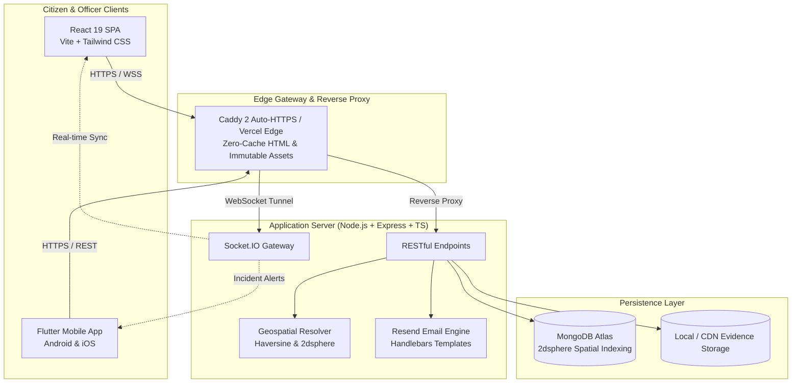

# SHTCA — Smart Hyperlocal Town & Civic Authority
> **Public Grievance Redressal, Spatial Redressal & Field Redressal Network**

An enterprise-grade, hyperlocal civic grievance management platform connecting citizens, municipal authorities, and field engineers. Features automatic geospatial routing, live incident tracking, multi-tier authority administration, and instant emergency broadcasts across web and mobile.

---

## 🏛️ Executive Summary & Product Vision (PRD)

Traditional public grievance systems suffer from information silos: citizen complaints are submitted through disparate channels, leading to duplicate tickets, lack of real-time visibility, and no verifiable audit trail of physical on-site resolution.

**SHTCA (Smart Hyperlocal Town & Civic Authority)** transforms citizen reports into a shared, spatially-aware incident intelligence pipeline:
- **Zero-Friction Citizen LODGE**: Citizens pinpoint issues using high-precision GPS. The system dynamically resolves the nearest municipal zonal office without forcing manual ward/zone selections.
- **Evidence-Backed Verification**: Corroboration is evidence-based (on-site photos, GPS stamping, resident confirmations) rather than popularity-only upvotes.
- **Multi-Admin Zonal Isolation**: Regional nodal officers only view complaints assigned to their jurisdiction, preventing jurisdictional overlap while apex administrators maintain citywide oversight.
- **Closed-Loop Action Taken Reports (ATR)**: Complaints cannot be closed without geotagged physical resolution evidence and field engineer inspection notes.

---

## 🏗️ System Architecture

SHTCA employs a modular, decoupled full-stack architecture designed for real-time responsiveness and high availability:



### Technology Stack

| Layer | Technologies | Key Role |
| :--- | :--- | :--- |
| **Citizen & Admin Web** | React 19, TypeScript, Vite, Tailwind CSS, Radix UI, Leaflet, Socket.IO Client | Responsive desktop & mobile portal with live map rendering |
| **Citizen Mobile App** | Flutter 3.x, Dart, `flutter_map`, `geolocator`, Android Release APK | Native Android citizen experience with runtime GPS locking |
| **Backend API** | Node.js 22, Express, TypeScript, Zod, Mongoose | High-performance modular API server with geospatial indexing |
| **Realtime Engine** | Socket.IO | Instant incident broadcasts and status timeline synchronization |
| **Transactional Email** | Resend API SDK, Handlebars (`.hbs`) | Instant password resets and citizen verification codes |
| **Reverse Proxy & TLS** | Caddy 2, Docker Compose, Vercel | Auto-HTTPS, strict cache-control, and immutable asset delivery |
| **Database** | MongoDB Atlas (Mongoose 2dsphere) | Geospatial proximity queries, incident indexing, and user auth |

---

## 🎨 Visual Identity & Civic Design System

SHTCA is built upon an authoritative, public-service visual discipline that balances accessibility with civic transparency.

### Color Palette

| Token | Hex Code | Visual Meaning |
| :--- | :--- | :--- |
| **Ashoka Blue (Primary)** | `#003366` | Institutional trust, authority, and official government branding |
| **Saffron Accent** | `#FF9933` | Priority notices, national civic identity |
| **India Green** | `#138808` | Resolved state, positive civic health index |
| **Emergency Crimson** | `#DC2626` | SOS alerts, critical infrastructure failures |
| **Muted Slate** | `#64748B` | Secondary metadata, landmarks, and timestamps |
| **Clean White / Card** | `#FFFFFF` / `#0F172A` | High-contrast accessible canvas for light and dark modes |

### Design Principles
1. **Clarity Over Flash**: High-density information layouts designed for citizens in stressful situations.
2. **Accessible by Default**: WCAG 2.1 AA compliant typography, prominent button hit-areas, and multilingual support (English & Hindi).
3. **No Impersonation**: Uses dignified public service discipline without infringing official state seals or emblems.

---

## ⚡ Core Features & Functional Specification

### 1. Citizen Portal & Mobile App
- **High-Precision GPS Location**: Pins user location automatically with runtime permissions (`geolocator`); fallback coordinates for Jaipur / pilot regions.
- **Dynamic Office Auto-Routing**: Citizen complaints are automatically assigned to the nearest municipal desk (e.g. *Malviya Nagar Division*, *Jaipur Heritage MC*, or *East Zone Division*) using Haversine distance calculations.
- **Interactive Civic Map**: Visualizes open, in-progress, and resolved complaints with color-coded severity markers and cluster radius.
- **Emergency Broadcast Banners**: Instant citywide or zonal civil alerts (water supply disruptions, severe weather warnings) powered by Socket.IO.
- **Citizen Corroboration**: Nearby residents can upvote or add on-site comments to existing complaints, eliminating duplicate reports.

### 2. Officer & Nodal Authority Console (Web Only)
- **Strict Zonal Isolation**: Regional administrators only access tickets assigned to their municipal jurisdiction.
- **Sub-Admin Creation**: Apex administrators can register additional departmental officers with predefined desk jurisdictions.
- **Action Taken Report (ATR) Workflow**: Officers upload resolution evidence, repair photographs, and field notes before closing a complaint.
- **Municipal Health Score**: Real-time algorithm grading regional infrastructure performance (0–100 index based on resolution speed and complaint volume).

---

## 🔐 Environment Variables Guide

Create a `.env` in `backend/` for local development or `.env.production` on the production server:

```env
# Server & Security
NODE_ENV=production
PORT=8000
JWT_SECRET=your_super_secret_jwt_key_here
DOMAIN_NAME=shtca.com
API_DOMAIN=api.shtca.com
FRONTEND_URL=https://shtca.com

# Database (MongoDB Atlas)
DATABASE_URL=mongodb+srv://<user>:<password>@cluster.mongodb.net/shtca?retryWrites=true&w=majority

# Resend Transactional Email
RESEND_API_KEY=re_123456789_abcdef...
EMAIL_FROM=SHTCA Civic Portal <support@shtca.com>

# Optional SMTP Fallback
EMAIL_HOST=mail.suremarkettips.com
EMAIL_PORT=587
EMAIL_USER=contact@suremarkettips.com
EMAIL_PASS=smtp_password_here

# Spatial & Map Tile Configuration
MAP_PROVIDER=osm
MAP_TILES_URL=https://tile.openstreetmap.org/{z}/{x}/{y}.png
```

---

## 🚀 Deployment & Installation

### Local Development Setup

1. **Clone & Install Dependencies**:
   ```bash
   git clone https://github.com/bhuvnesh-nama/shtca.git
   cd shtca

   # Backend
   cd backend && npm install
   npm run dev

   # Frontend (separate terminal)
   cd frontend && npm install
   npm run dev
   ```

2. **Mobile App (Flutter)**:
   ```bash
   cd mobile
   flutter pub get
   flutter run
   ```

### Production Docker Deployment (VPS)
```bash
# Build and run with Caddy reverse proxy and auto-HTTPS
docker compose -f docker-compose.prod.yml up -d --build
```

### Vercel Frontend Deployment
A production-ready [vercel.json](./vercel.json) is included with:
- Global CORS headers (`Access-Control-Allow-Origin: *`)
- `Cache-Control: no-cache` for HTML/PWA files
- SPA rewrite rules routing `/api/*` to `https://api.shtca.com`

---

## 📱 Mobile App (Android APK)

Pre-built installable Android packages are located under:
- **Release APK (Optimized 49.5 MB)**: `mobile/build/app/outputs/flutter-apk/app-release.apk`
- **Debug APK (124.7 MB)**: `mobile/build/app/outputs/flutter-apk/app-debug.apk`

Install directly to an Android device via ADB:
```bash
adb install -r mobile/build/app/outputs/flutter-apk/app-release.apk
```

---

## 📄 License
This project is developed for the Smart Hyperlocal Civic Infrastructure Initiative. Distributed under the ISC License.
