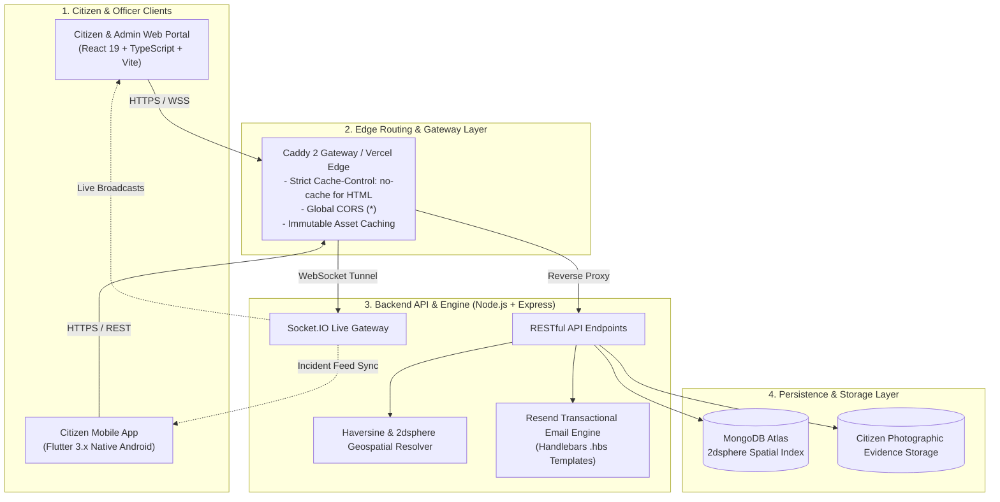

<div align="center">

# 🏛️ SHTCA — Smart Hyperlocal Town & Civic Authority
### Public Grievance Redressal, Spatial Intelligence & Field Action Network

[](https://github.com/bhuvnesh-nama/shtca/releases)
[](https://flutter.dev)
[](https://react.dev)
[](https://nodejs.org)
[](https://www.mongodb.com)
[](./LICENSE)

<br/>

**[🌐 Live Citizen Portal](https://shtca.com)** &nbsp;|&nbsp;
**[📱 Download Android APK](https://github.com/bhuvnesh-nama/shtca/releases/latest/download/app-release.apk)** &nbsp;|&nbsp;
**[📡 Production API Gateway](https://api.shtca.com)** &nbsp;|&nbsp;
**[📦 All GitHub Releases](https://github.com/bhuvnesh-nama/shtca/releases)**

---

### 🇮🇳 *Satyameva Jayate* &bull; Transparent, Spatially-Routed Civic Administration

</div>

<br/>

## 📌 Executive Overview

Traditional public grievance portals suffer from fragmented communication, opaque ticketing queues, manual zone confusion, and lack of verified physical resolution.

**SHTCA** is an end-to-end, multi-tier civic infrastructure platform connecting citizens with regional municipal corporations and field engineering desks. By combining high-precision GPS positioning, dynamic geospatial routing, real-time WebSocket synchronization, and photographic Action Taken Reports (ATR), SHTCA ensures that every civic issue—from road hazards and power outages to water shortages and sanitation—is resolved with verifiable accountability.

---

## ✨ Key Platform Innovations

| Feature | Citizen Impact | Municipal / Officer Impact |
| :--- | :--- | :--- |
| **📍 Dynamic Geospatial Auto-Routing** | Zero manual ward/zone selection. GPS coordinates automatically resolve the nearest municipal desk. | Tickets are automatically distributed to the exact jurisdiction responsible for on-site redressal. |
| **🛡️ Evidence-Backed ATR Closure** | Citizens can see photo proof of completed repairs and read field engineer notes before a case is closed. | Officers must upload verifiable photographic evidence and timestamped inspection logs to resolve complaints. |
| **🔒 Strict Zonal Admin Isolation** | Citizens only see alerts and complaints relevant to their neighbourhood or immediate area. | Regional nodal officers only view complaints within their jurisdiction; apex directors retain citywide oversight. |
| **⚡ Real-time Civic Alerts (WebSockets)** | Instant broadcast notifications for emergency water cuts, severe weather advisories, or road repairs. | One-click dispatch of targeted civil advisories across web and mobile citizen devices. |
| **📱 Dedicated Native Mobile App** | 100% citizen-focused native Android app with runtime GPS locking and offline resilience. | Web-only officer console keeps sensitive administrative controls off personal mobile screens. |
| **🌐 Bilingual Accessibility** | One-click toggle between English and Hindi across the entire interface. | Enhances grassroots civic participation across diverse demographics. |

---

## 🏗️ Architecture & Data Flow



---

## 🛠️ Technology Stack

```
├── Frontend (Web SPA)
│   ├── React 19 & TypeScript 5
│   ├── Vite 8 (Hot-Module Replacement & Optimized Production Bundles)
│   ├── Tailwind CSS (Civic Public-Service Design Tokens)
│   ├── Radix UI Primitives & Lucide Icons
│   ├── Leaflet & MapLibre GL JS (Interactive Spatial Maps)
│   └── Socket.IO Client (Real-time Broadcasts & Timeline Sync)
│
├── Mobile Application (Android)
│   ├── Flutter 3.x & Dart
│   ├── flutter_map & latlong2 (OpenStreetMap Tile Engine)
│   ├── geolocator (High-Accuracy Runtime GPS Location)
│   ├── http & provider (Clean State Architecture)
│   └── Optimized Release APK (49.5 MB lightweight installable)
│
├── Backend Services (REST API)
│   ├── Node.js 22 & Express (ESM Modular Architecture)
│   ├── MongoDB Atlas with Mongoose (2dsphere Spatial Geometries)
│   ├── Socket.IO 4.x (Live Multi-Client Synchronization)
│   ├── Resend Official SDK (Transactional Emails & OTP Verification)
│   ├── Handlebars (Templated HTML Email Notifications)
│   └── Multer (On-Site Citizen Evidence Image Storage)
│
└── Infrastructure & DevOps
    ├── Caddy 2 (Automatic TLS, Reverse Proxy, Cache-Busting)
    ├── Docker & Docker Compose (Zero-Downtime Multi-Container Stacks)
    ├── Vercel (Edge SPA Hosting & Asset Optimization)
    └── GitHub Actions (Automated CI/CD Deployment & APK Release Workflows)
```

---

## 🎨 Civic Design System & Theme

SHTCA adheres to an authoritative, public-service visual language inspired by modern civic platforms.

### Core Color Palette

| Token | Hex Value | Semantic Role |
| :--- | :--- | :--- |
| **Ashoka Blue (Primary)** | `#003366` | Institutional trust, navigation bar, primary buttons, and official badges |
| **Indian Saffron** | `#FF9933` | Tricolor top accent bar, urgency indicators, and active alerts |
| **Indian Green** | `#138808` | Verified resolution status, healthy civic score, positive confirmation |
| **Emergency Crimson** | `#DC2626` | SOS reports, high-severity infrastructure hazards, and critical notices |
| **Civic Slate** | `#64748B` | Secondary landmarks, timestamps, and metadata |
| **Clean Background** | `#F8FAFC` / `#0B1329` | High-contrast readable canvas supporting light and dark themes |

---

## 📱 Mobile Application (Android APK Download)

The SHTCA Citizen Mobile App is packaged as a standalone Android APK:

| Package | Size | Target Architecture | Download Link |
| :--- | :--- | :--- | :--- |
| **Official Release APK** | **49.5 MB** | `arm64-v8a`, `armeabi-v7a`, `x86_64` | [📥 Download app-release.apk](https://github.com/bhuvnesh-nama/shtca/releases/latest/download/app-release.apk) |
| **Debug Development APK** | **124.7 MB** | Universal | [📦 Download from Releases](https://github.com/bhuvnesh-nama/shtca/releases) |

### Installing via ADB (Command Line)
```bash
adb install -r mobile/build/app/outputs/flutter-apk/app-release.apk
```

---

## ⚙️ Environment Variables Reference

Create a `.env` in `backend/` for local development or `.env.production` on the production server:

```env
# ==========================================
# 1. CORE APPLICATION & DOMAINS
# ==========================================
NODE_ENV=production
PORT=8000
JWT_SECRET=your_super_secret_jwt_random_string_here
DOMAIN_NAME=shtca.com
API_DOMAIN=api.shtca.com
FRONTEND_URL=https://shtca.com

# ==========================================
# 2. DATABASE PERSISTENCE (MongoDB Atlas)
# ==========================================
DATABASE_URL=mongodb+srv://<username>:<password>@cluster0.abcde.mongodb.net/shtca?retryWrites=true&w=majority

# ==========================================
# 3. TRANSACTIONAL EMAIL ENGINE (Resend)
# ==========================================
RESEND_API_KEY=re_your_resend_api_key_here
EMAIL_FROM=SHTCA Civic Portal <support@shtca.com>

# Optional legacy SMTP fallback (if Resend key is not configured)
EMAIL_HOST=mail.suremarkettips.com
EMAIL_PORT=587
EMAIL_USER=contact@suremarkettips.com
EMAIL_PASS=your_smtp_password

# ==========================================
# 4. MAP & SPATIAL PROVIDERS
# ==========================================
MAP_PROVIDER=osm
MAP_TILES_URL=https://tile.openstreetmap.org/{z}/{x}/{y}.png
```

---

## 🚀 Step-by-Step Installation & Local Setup

### 1. Prerequisites
- **Node.js** v20.x or v22.x
- **Flutter SDK** v3.24+ (for mobile development)
- **MongoDB** instance (Local or MongoDB Atlas)
- **Git**

### 2. Backend Setup
```bash
cd backend
npm install
npm run dev
# Backend server runs on http://localhost:8000
```

### 3. Frontend Web Setup
```bash
cd frontend
npm install
npm run dev
# Web application starts at http://localhost:5173
```

### 4. Mobile App Setup (Flutter)
```bash
cd mobile
flutter pub get

# Run on connected Android device or emulator
flutter run

# Or build the release APK directly:
flutter build apk --release
```

---

## 🐳 Production Deployment (Docker + Caddy)

For automated zero-downtime production deployment on any VPS (Ubuntu/Debian):

```bash
# Clone the repository
git clone https://github.com/bhuvnesh-nama/shtca.git /opt/shtca
cd /opt/shtca

# Configure production environment variables
cp .env.production.example .env.production
nano .env.production

# Spin up backend, Caddy reverse-proxy, and auto-HTTPS containers
docker compose --env-file .env.production -f docker-compose.prod.yml up -d --build
```

---

## 🏷️ Publishing a GitHub Release with APK

Our repository includes an automated GitHub Actions workflow [`.github/workflows/release-apk.yml`](./.github/workflows/release-apk.yml) that builds and publishes the Flutter Release APK to GitHub Releases.

To create a new release:
```bash
# Tag the current release version
git tag v1.0.0

# Push tag to trigger GitHub Release builder
git push origin v1.0.0
```
GitHub Actions will automatically compile the Flutter Android APK and attach `app-release.apk` to the new GitHub Release for instant public download.

---

## 📋 Primary REST API Endpoints

| Method | Endpoint | Description |
| :--- | :--- | :--- |
| `POST` | `/api/auth/register` | Citizen account registration (Name, Phone, Email, Password) |
| `POST` | `/api/auth/login` | Citizen & Officer login with JWT access token generation |
| `POST` | `/api/auth/authority/register` | Apex Admin endpoint to create new zonal department officers |
| `POST` | `/api/auth/forgot-password` | Dispatches password reset link via Resend email |
| `GET` | `/api/incidents` | Geospatial incident feed with proximity filtering & severity tags |
| `POST` | `/api/incidents` | Lodges new civic grievance with photographic evidence & GPS pin |
| `PATCH` | `/api/incidents/:id/status` | Officers update grievance lifecycle (`in_progress`, `resolved`) with ATR |
| `POST` | `/api/incidents/:id/upvote` | Citizen corroboration confirming active local incidents |
| `GET` | `/api/broadcasts` | Fetches active emergency civic advisories and city alerts |

---

## 📄 License

Distributed under the **ISC License**. Developed for transparent, accountable, and citizen-first civic governance.
